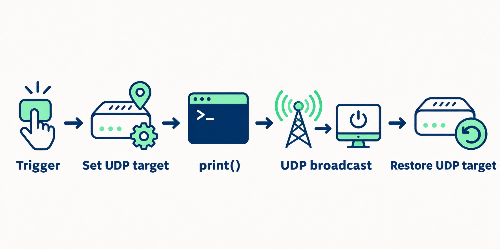

English | [Türkçe](README.tr.md)


# shelly-wol · Shelly Wake on LAN

## What it does

This Shelly WOL script sends a Wake-on-LAN magic packet on your local network. Trigger it from a local HTTP URL or when the Shelly's output turns on. Keep the PC connected to continuous power so its network adapter can listen for the packet.

An earlier revision of the same method woke one PC with an Intel I225-V Ethernet adapter using one Shelly Plug M Gen3 (firmware 1.8.99). Other script-capable Shelly Gen2 and Gen3 devices are expected to work and remain untested.

## Why use the debug logger?

The Shelly scripting API has no general-purpose UDP send function. The firmware can already stream debug logs over UDP, so this script uses the logger to carry the magic packet. [Shelly scripting API](https://shelly-api-docs.shelly.cloud/gen2/Scripts/Overview/) · [Community request for script UDP support](https://community.shelly.cloud/topic/14434/)

## How it works



1. Read the device's current `debug.udp.addr`, then use `Sys.SetConfig` to point UDP logging at the LAN broadcast address on port `9`.
2. After one second, use `print()` to write the 102-byte magic pattern three times by default. The pattern is six `FF` bytes followed by 16 copies of the target MAC. `String.fromCharCode()` builds the raw bytes, and the logger sends them inside its UDP log messages.
3. Wait another 1.5 seconds for the log messages to drain, then restore the previous address exactly, including `null` if UDP logging was disabled. The script saves the address in persistent storage before redirecting the logs so it can recover after an interruption. [Shelly system configuration](https://shelly-api-docs.shelly.cloud/gen2/ComponentsAndServices/Sys/)

## Requirements

- A Shelly Gen2 or Gen3 device with scripting support and a free script slot. The relay trigger also needs `switch:0`.
- The Shelly and the PC's wired Ethernet adapter on the same broadcast-capable LAN.
- In BIOS/UEFI, enable **Wake on LAN** or **Power On by PCI-E**, and disable **ErP** so the adapter can retain standby power.
- In the OS or NIC driver, enable **Wake on Magic Packet**. Use the wired adapter's MAC address. It must have six colon-separated hex bytes and contain neither a `00` byte nor a `0A` byte.
- On Windows, disable **Fast Startup** when testing wake after shutdown. Which power states the PC can wake from depends on its firmware, NIC and OS. Start by testing from sleep. [Microsoft's Wake-on-LAN power-state documentation](https://learn.microsoft.com/en-us/windows/win32/power/system-power-states#wake-on-lan-behavior)

## Install

### From the command line

Run from the repo directory on a computer with Bash and Python 3 that can reach the Shelly's local RPC without a login. Replace the example device IP and MAC with your own.

```sh
./install.sh 192.0.2.42 02:11:22:33:44:55
```

The installer creates, uploads, enables at boot and starts the script. It prints the wake URL with the assigned script ID. For a blank `CONFIG.broadcast`, it uses the broadcast address of the device's assumed `/24` subnet. For another subnet size, set `CONFIG.broadcast` in [shelly-wol.js](shelly-wol.js) before running it.

### From the Shelly web interface

Use this method if your Shelly requires a login for local RPC.

1. Open the device's web interface, go to **Scripts**, and create a script named `shelly-wol`.
2. Paste [shelly-wol.js](shelly-wol.js) and set `CONFIG.mac` and `CONFIG.broadcast`. Enter just the broadcast IP in `broadcast`, such as `192.0.2.255` for `192.0.2.0/24`. The separate `port` defaults to `9` and `repeats` defaults to `3`.
3. Save, enable the script to run at startup, and start it. Leave `httpTrigger` on for the local URL. Set `switchTrigger` to `false` for HTTP-only operation.

### Wake from the local network

Call `http://<device-ip>/script/<id>/wake` with the device's actual IP and script ID.

```sh
curl -i http://192.0.2.42/script/2/wake
```

HTTP `202` means the script accepted the request. A repeated request during a send returns `409`. Check the PC to confirm it woke.

## Remote trigger from the Shelly app

With `switchTrigger: true` (the default), the script sends the packet when the `switch:0` output turns on. With the Shelly online in the Shelly Smart Control app, turn it off and back on if it is already on. If it is off, turn it on. This toggles power to anything connected to the relay. **Power the target PC from a separate outlet.** Keep the script's HTTP endpoint on your LAN or access it through a VPN.

## Limitations

- Carrying raw bytes in debug logs is undocumented. Firmware updates may change how bytes or broadcasts are handled. Retest after updating.
- The tested logger drops `00` and splits the log line at `0A`. Either byte in the MAC breaks the magic pattern.
- UDP debug redirection lasts about 2.5 seconds per wake. Other device log messages may also be broadcast on the LAN during that window. Run one instance and avoid changing the logging target during a wake.
- Stopping the script or losing power during a send can leave the temporary log target active until the script runs again. On startup, the script restores the saved address if the temporary target is still active. If recovery fails, restore the previous UDP debug setting in the Shelly web interface.

## Tested devices

| Shelly device | Firmware | Target | Result |
| --- | --- | --- | --- |
| Shelly Plug M Gen3 | 1.8.99 | One PC with an Intel I225-V Ethernet adapter | Three real PC boots with an earlier revision of the same method |
| Shelly Plug M Gen3 | 1.8.99 | Mac on the same LAN, UDP unicast | Three exact 102-byte patterns captured from this script. The previous UDP log target was restored. |

## Troubleshooting

| Symptom | Check |
| --- | --- |
| Installer rejects the MAC | Enter the wired NIC's six colon-separated hex bytes. Check for `00` and `0A` octets. |
| Wake URL returns `404` | Check the script ID, make sure the script is running and confirm `httpTrigger` is enabled. Look for configuration errors in the script log. |
| Wake URL returns `409` or `503` | For `409`, wait a few seconds. For `503`, check the script log and the UDP debug setting. |
| HTTP `202` but the PC stays asleep | Verify the LAN broadcast address, MAC and standby power. Check for guest Wi-Fi or client isolation. Try a conventional WoL sender on the same LAN and test from sleep first. |
| Local HTTP works but the app trigger does not | Check that `switchTrigger` is enabled and that the device exposes a `switch:0` output that transitions from off to on. |

## FAQ

### Do I need another computer running all the time?

The Shelly sends the packet itself. The target PC needs standby power and an Ethernet link that supports wake.

### Will Shelly Gen2 and other Gen3 models work?

The script targets Gen2 and Gen3 devices with scripting support. The table lists the hardware and firmware verified so far.

### Can I use a MAC with `00` or `0A`?

Use a conventional WoL sender for those MACs. This logger cannot transmit the required pattern for them.

### Can I wake the PC after a full shutdown?

That depends on whether the board and NIC stay armed for WoL in that power state. Test from sleep first, then test shutdown separately.

## License

[MIT](LICENSE)
