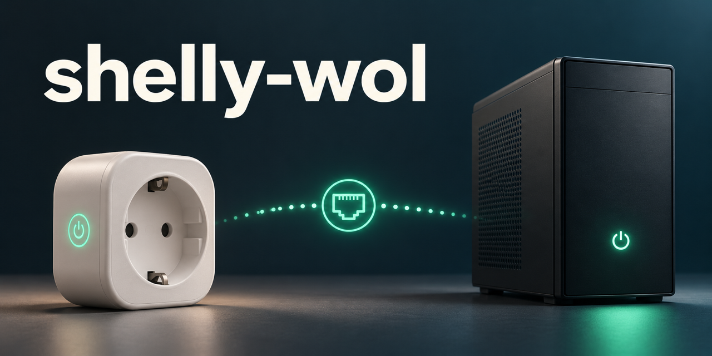
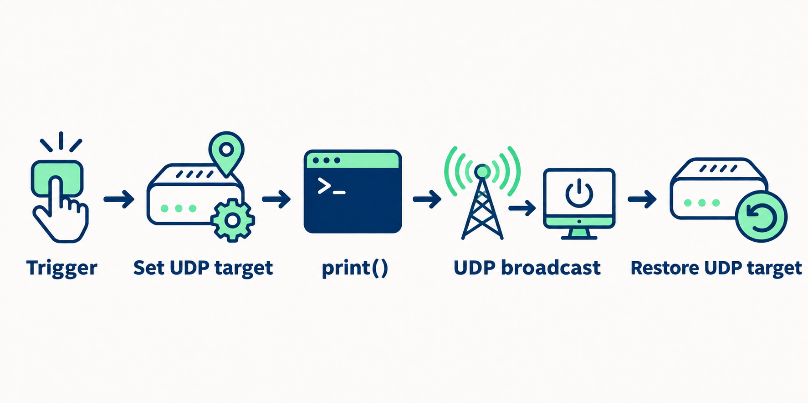

[English](README.md) | Türkçe



# shelly-wol · Shelly ile Wake on LAN

## Ne işe yarar?

Bu Shelly WOL betiği yerel ağınıza bir Wake-on-LAN paketi (magic packet) gönderir. Betiği yerel HTTP adresi üzerinden ya da Shelly çıkışı açıldığında tetikleyebilirsiniz. Ağ kartının paketi dinleyebilmesi için bilgisayarın elektriği kesilmemelidir.

Aynı yöntemin önceki bir sürümü, 1.8.99 yazılımını çalıştıran bir Shelly Plug M Gen3 ile Intel I225-V Ethernet kartlı bir bilgisayarı uyandırdı. Betik desteği olan diğer Shelly Gen2 ve Gen3 cihazlarında da çalışması bekleniyor, ancak henüz bu cihazlarda denenmedi.

## Neden hata ayıklama günlüğü kullanılıyor?

Shelly betik API'sinde genel amaçlı bir UDP gönderme işlevi yok. Cihaz yazılımı hata ayıklama günlüklerini UDP üzerinden gönderebildiği için betik bu kanalı kullanarak magic packet'i iletir. [Shelly betik API'si](https://shelly-api-docs.shelly.cloud/gen2/Scripts/Overview/) · [Topluluğun betiklerde UDP desteği talebi](https://community.shelly.cloud/topic/14434/)

## Nasıl çalışır?



1. Cihazın mevcut `debug.udp.addr` değerini okur. Ardından `Sys.SetConfig` ile UDP günlüklerini yerel ağın yayın adresindeki `9` numaralı porta yönlendirir.
2. Bir saniye sonra `print()` ile 102 baytlık diziyi varsayılan olarak üç kez yazdırır. Dizi, altı `FF` baytının ardından hedef MAC adresinin 16 kez tekrarlanmasıyla oluşur. `String.fromCharCode()` ham baytları oluşturur ve günlük sistemi bunları UDP günlük iletilerinde gönderir.
3. Günlük iletilerinin gönderilmesi için 1,5 saniye daha bekler ve önceki adresi aynen geri yükler. UDP günlükleri kapalıysa bu değer `null` olur. Betik, bir kesintiden sonra adresi geri yükleyebilmek için günlükleri yönlendirmeden önce adresi kalıcı depolamaya kaydeder. [Shelly sistem yapılandırması](https://shelly-api-docs.shelly.cloud/gen2/ComponentsAndServices/Sys/)

## Gereksinimler

- Betik desteği ve boş bir betik yuvası olan Shelly Gen2 veya Gen3 cihazı. Röleyle tetikleme için ayrıca `switch:0` çıkışı gerekir.
- Shelly ile bilgisayarın kablolu Ethernet kartı, yayın paketlerinin iletilebildiği aynı yerel ağda olmalı.
- BIOS/UEFI'de **Wake on LAN** veya **Power On by PCI-E** seçeneğini açın. Ağ kartı beklemede güç almaya devam etsin diye **ErP**'yi kapatın.
- İşletim sisteminde veya ağ kartı sürücüsünde **Wake on Magic Packet** seçeneğini açın. Kablolu ağ kartının MAC adresini kullanın. Adres, iki noktayla ayrılmış altı onaltılık bayttan oluşmalı ve `00` ya da `0A` baytı içermemeli.
- Windows'ta kapatma sonrası uyandırmayı deneyecekseniz **Hızlı Başlatma**'yı kapatın. Bilgisayarın hangi güç durumlarından uyanabileceği donanım yazılımına, ağ kartına ve işletim sistemine bağlıdır. İlk denemeyi uyku modunda yapın. [Microsoft'un Wake-on-LAN güç durumları belgesi](https://learn.microsoft.com/en-us/windows/win32/power/system-power-states#wake-on-lan-behavior)

## Kurulum

### Komut satırından

Komut dosyasını, Bash ve Python 3 yüklü ve Shelly'nin yerel RPC arayüzüne oturum açmadan erişebilen bir bilgisayarda, depo dizininden çalıştırın. Örnekteki cihaz IP'sini ve MAC adresini kendi değerlerinizle değiştirin.

```sh
./install.sh 192.0.2.42 02:11:22:33:44:55
```

Kurulum aracı betiği oluşturur, yükler, cihaz açılışında çalışacak şekilde ayarlar ve başlatır. Atanan betik kimliğiyle birlikte uyandırma adresini yazdırır. `CONFIG.broadcast` boşsa Shelly'nin `/24` alt ağında olduğunu varsayarak yayın adresini hesaplar. Farklı bir alt ağ maskesi kullanıyorsanız aracı çalıştırmadan önce [shelly-wol.js](shelly-wol.js) dosyasındaki `CONFIG.broadcast` değerini ayarlayın.

### Shelly web arayüzünden

Shelly'niz yerel RPC erişimi için oturum açmayı gerektiriyorsa bu yöntemi kullanın.

1. Cihazın web arayüzünde **Scripts** bölümünü açıp `shelly-wol` adında bir betik oluşturun.
2. [shelly-wol.js](shelly-wol.js) içeriğini yapıştırıp `CONFIG.mac` ve `CONFIG.broadcast` değerlerini ayarlayın. `broadcast` alanına yalnızca yayın IP'sini girin. Örneğin `192.0.2.0/24` ağı için `192.0.2.255` kullanılır. `port` varsayılan olarak `9`, `repeats` ise `3` değerindedir.
3. Kaydedin, betiği cihaz açılışında çalışacak şekilde ayarlayın ve başlatın. Yerel HTTP adresini kullanmak için `httpTrigger` açık kalsın. Yalnızca HTTP ile tetiklemek için `switchTrigger` değerini `false` yapın.

### Yerel ağdan uyandırma

`http://<cihaz-ip>/script/<id>/wake` adresini, cihazın gerçek IP'si ve betik kimliğiyle çağırın.

```sh
curl -i http://192.0.2.42/script/2/wake
```

HTTP `202`, isteğin kabul edildiğini gösterir. Gönderim sürerken yapılan ikinci istek `409` döndürür. Bilgisayarın uyanıp uyanmadığını ayrıca kontrol edin.

## Shelly uygulamasından uzaktan tetikleme

`switchTrigger: true` (varsayılan) olduğunda betik, `switch:0` çıkışı açılınca paketi gönderir. Shelly Smart Control uygulamasında cihaz çevrimiçiyken, çıkış zaten açıksa kapatıp yeniden açın. Kapalıysa açmanız yeterli. Bu işlem röleye bağlı cihazların elektriğini de kesip verebilir. **Uyandıracağınız bilgisayarı ayrı bir prize bağlayın.** Betiğin HTTP uç noktasını yerel ağda tutun veya VPN üzerinden erişin.

## Sınırlamalar

- Ham baytların hata ayıklama günlüğüyle iletilmesi belgelenmemiş bir davranış. Cihaz yazılımı güncellemeleri baytların veya yayın paketlerinin işlenme biçimini değiştirebilir. Güncellemeden sonra tekrar deneyin.
- Test edilen günlük sistemi `00` baytını atar ve `0A` baytında satırı böler. MAC adresinde bu baytlardan biri varsa magic packet bozulur.
- Her tetiklemede UDP hata ayıklama günlükleri yaklaşık 2,5 saniye boyunca farklı bir hedefe yönlendirilir. Bu sırada diğer cihaz günlükleri de yerel ağa yayınlanabilir. Betiğin tek bir kopyasını çalıştırın ve gönderim sırasında günlük hedefini değiştirmeyin.
- Gönderim sırasında betik durursa veya elektrik kesilirse geçici günlük hedefi betik yeniden çalışana kadar etkin kalabilir. Betik başlatıldığında geçici hedef hâlâ etkinse kayıtlı adresi geri yükler. Geri yükleme başarısız olursa önceki UDP günlük ayarını Shelly web arayüzünden geri yükleyin.

## Test edilen cihazlar

| Shelly cihazı | Cihaz yazılımı | Hedef | Sonuç |
| --- | --- | --- | --- |
| Shelly Plug M Gen3 | 1.8.99 | Intel I225-V Ethernet kartlı bir bilgisayar | Aynı yöntemin önceki bir sürümüyle bilgisayar üç kez açıldı. |
| Shelly Plug M Gen3 | 1.8.99 | Aynı yerel ağdaki Mac, UDP unicast | Bu betikten gelen 102 baytlık dizi üç kez eksiksiz yakalandı. Önceki UDP günlük hedefi geri yüklendi. |

## Sorun giderme

| Belirti | Kontrol edin |
| --- | --- |
| Kurulum aracı MAC adresini reddediyor | Kablolu ağ kartının iki noktayla ayrılmış altı onaltılık baytını girin. `00` ve `0A` baytları olup olmadığına bakın. |
| Uyandırma adresi `404` döndürüyor | Betik kimliğini, betiğin çalıştığını ve `httpTrigger` ayarının açık olduğunu kontrol edin. Yapılandırma hataları için betik günlüğüne bakın. |
| Uyandırma adresi `409` veya `503` döndürüyor | `409` için birkaç saniye bekleyin. `503` için betik günlüğüne ve UDP hata ayıklama ayarına bakın. |
| HTTP `202` dönüyor ama bilgisayar uyanmıyor | Yayın adresini, MAC adresini ve ağ kartının beklemede güç aldığını doğrulayın. Misafir ağı veya istemci yalıtımı olup olmadığına bakın. Aynı ağda standart bir WoL aracıyla, önce uyku modundan uyandırmayı deneyin. |
| Yerel HTTP çalışıyor ama uygulamadan tetiklenmiyor | `switchTrigger` ayarının açık olduğunu ve cihazın `switch:0` çıkışının kapalıyken açıldığını kontrol edin. |

## Sık sorulan sorular

### Sürekli açık başka bir bilgisayar gerekir mi?

Paketi Shelly cihazı gönderir. Uyandırılacak bilgisayarın beklemede elektrik alması ve uyandırmayı destekleyen bir Ethernet bağlantısının olması gerekir.

### Shelly Gen2 ve diğer Gen3 modellerinde çalışır mı?

Betik, betik desteği olan Gen2 ve Gen3 cihazları hedefliyor. Şu ana kadar doğrulanan donanım ve yazılım sürümleri tabloda yer alıyor.

### `00` veya `0A` içeren bir MAC adresi kullanabilir miyim?

Bu adresler için standart bir WoL göndericisi kullanın. Günlük sistemi bu adreslerin gerektirdiği bayt dizisini iletemez.

### Bilgisayarı tamamen kapattıktan sonra uyandırabilir miyim?

Bu, anakartın ve ağ kartının o güç durumunda WoL paketini dinlemeye devam edip etmediğine bağlı. Önce uyku modunda, ardından tam kapatma sonrasında deneyin.

## Lisans

[MIT](LICENSE)
